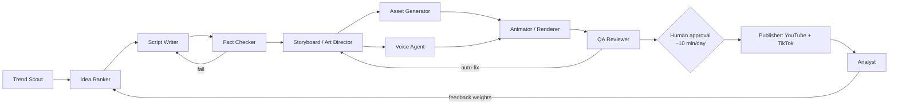

# Build Plan: Faceless Curiosity-Science Channel + Agent Pipeline

_Status: **approved 2026-11-27**, build starts with Phase 0/1. Research and sources are in [RESEARCH.md](RESEARCH.md)._

**Decisions (2026-11-27)**
- **Audience:** general audience. The animation will naturally appeal to kids, but nothing targets or labels itself as "for kids." Videos are set to "not made for kids" unless QA flags one.
- **Models:** Opus 5.5 for research, planning, writing and reviewing; Haiku 5.5 only for mechanical steps whose output is checked downstream. See [Model routing](#model-routing).
- **Voice:** Kokoro (free, local) to start.
- **Storage and review:** Dropbox instead of Google Drive.
- **Brand:** the name is **Wonderscraps** (`@wonderscraps` on all four platforms), the style is **Paper Cutout** with calmer motion, and the voice is **Kokoro Michael**. See [BRAND.md](BRAND.md).
- **Platforms:** YouTube, TikTok, Instagram Reels and Facebook Reels. Posting to Instagram through the API requires an Instagram professional account linked to a Facebook Page, plus a Meta developer app.

---

## 1. The business in one paragraph

We run one brand on YouTube and TikTok: **family-friendly curiosity science** ("What if…?", "How does it work?", animal superpowers, your amazing body, space and scale, myth-busting). It is aimed at curious 9–14 year-olds and enjoyable for their parents, so it is a **general-audience** channel, not "made for kids."

The output is:
- **one YouTube Short a day**, also cut to a **61–75s TikTok version** (Creator Rewards only pays on videos over a minute);
- **one 8–12 minute YouTube deep-dive a week**.

Shorts and TikTok bring subscribers. The long-form videos earn the 8,000 watch hours YouTube will require from Feb 1, 2027, and Education-tier ad rates. Sponsors, affiliate links and a parent and teacher email list are the second revenue layer.

Every video is fact-checked against real sources and visually varied, because both accuracy and variation are what keep a faceless channel monetized under YouTube's 2026 inauthentic-content rules.

---

## 2. Pipeline: the agent system

The pipeline is a **code-orchestrated workflow**: each "agent" is a focused Claude call with a strict JSON output schema, plus tools only where needed. It is not an open-ended autonomous agent. That keeps it cheap, repeatable and debuggable.

| # | Agent | What it does | Tools / inputs | Output |
|---|---|---|---|---|
| 1 | **Trend Scout** | Finds topics with demand: YouTube search for fast-rising videos in our pillars ("outliers" = views ÷ channel average), Google Trends, seasonal calendar (eclipses, holidays, back to school), our own analytics | YouTube Data API, pytrends-style trends, optional vidIQ | 20–40 raw ideas a week |
| 2 | **Idea Ranker** | Scores ideas on curiosity gap, visual potential, evergreen value, kid-safety, how much we've already covered it, and past performance of the pillar | Idea DB + analytics weights | Ranked backlog |
| 3 | **Script Writer** | Writes the hook-first script with the required beat structure: hook question (≤2s) → surprise → 2–3 visual beats → "crazy part" → loop line. Grade 5–7 reading level, never babyish. Also writes the TikTok bonus segment and title, description and tags. | Brand voice guide, format variants | Script JSON with on-screen text and claims list |
| 4 | **Fact Checker** | Verifies every claim with web search and needs 2 reputable sources each (NASA, NIH, NOAA, Smithsonian, Britannica, universities). It rewrites or rejects weak claims, and sources go in the description. | Claude web search tool | Pass/fail + citations |
| 5 | **Storyboard / Art Director** | Turns the script into 8–14 shots, picks an animation template per shot (zoom, pan, diagram, scale comparison, counter, split-screen), writes image prompts in the locked brand style, and **rotates templates and music** so no two consecutive videos look the same | Style bible, asset library | Shot list JSON |
| 6 | **Asset Generator** | Generates illustrations in a fixed style (same style prompt, seeds and palette) and **reuses** library assets (planets, organs, animals, icons), so cost falls over time | Image API (Flux via fal.ai or Replicate) | PNG layers |
| 7 | **Voice Agent** | Narration with free local **Kokoro TTS** (Apache-2.0), with an ElevenLabs upgrade path. Produces word-level timestamps (whisper.cpp) for captions. | Kokoro / whisper.cpp | WAV + word timings |
| 8 | **Animator / Renderer** | **Remotion** (React video framework) renders 1080×1920 for Shorts and TikTok and 1920×1080 for long-form: parallax, camera moves, animated diagrams, kinetic word-highlight captions in safe zones, SFX, ducked music, loudness normalized to −14 LUFS. Also renders the long-form thumbnail. | Remotion + ffmpeg | MP4s + thumbnail |
| 9 | **QA Reviewer** | **Automatic checks:** duration, resolution, loudness, black or frozen frames, caption safe zones, audio–caption sync. **Claude vision review** of sampled frames against the script. **Policy checks:** kid-safety, made-for-kids factor test, title and thumbnail honesty, AI-disclosure decision, **similarity to the last 30 uploads** (catches the "templated" look). Fails go back to Storyboard up to 2 times, then to a human. | ffprobe, ebur128, Claude vision | QA report + pass/fail |
| 10 | **Human approval** | Rendered videos and their QA reports land in a Dropbox `Review/` folder. **Approve by moving the video to `Approved/`** in the Dropbox phone app; move it to `Rejected/` (optionally with a `.txt` note) to send it back. Recommended for at least the first 60 days, because one bad video can demonetize the whole channel. | Dropbox app folder | Approved |
| 11 | **Publisher** | **YouTube:** Data API `videos.insert` with scheduled `publishAt`, audience setting, synthetic-media flag and thumbnail; about 6 uploads a day on the default quota. **TikTok:** Content Posting API. We start with **inbox upload** (you tap Post in the app, about 30 seconds) and apply for the **Direct Post audit**; until audited, API direct posts are private-only. | YouTube Data API v3, TikTok Content Posting API | Live posts |
| 12 | **Analyst** | Daily: views, retention curve, swipe-away, CTR, subscribers gained per video. Updates the Idea Ranker weights. Weekly report to email or Sheet with kill or double-down calls. | YouTube Analytics API, TikTok API | Report + weights |

### Model routing

The rule is conservative: **Opus 5.5** handles anything that involves research, planning, creative judgment or review. **Haiku 5.5** handles only mechanical transforms, where the output is validated by code or reviewed later by an Opus step. If a step is in doubt, it goes to Opus.

| Opus 5.5 (`claude-opus-5-5`) | Haiku 5.5 (`claude-haiku-5-5`) |
|---|---|
| Trend Scout analysis + Idea Ranker (which topics to make) | Triage of raw trend data: classify and dedupe scraped titles into pillars before Opus ranks them |
| Script Writer (hook, beats, title) | Narration prep for TTS: numbers, units and symbols to words; pronunciation respellings |
| Fact Checker (web search, citations) | Expanding each storyboard shot spec into a full style-locked image prompt |
| Storyboard / Art Director | Metadata packaging from the Opus-written title and summary: description with sources, hashtags, chapter timestamps, TikTok caption |
| QA Reviewer (vision + policy checks) | Daily analytics digest (numbers → short summary) |
| Long-form outline and narration | |
| Weekly analytics strategy report | |

Estimated LLM cost is about **$1.00–1.50 per Short**. Almost all of it sits in the Opus steps, which is where quality matters. Fact-check research with web search is the largest single item: about $0.035 per search, including the pages Opus reads. The first measured run (pilot 01, 2026-11-27) cost $3.29 because every revision round re-checked the whole script. Revision rounds now re-check only new, changed or failed claims, and research is capped at about 2 searches per claim (16 max). Research now goes through the Message Batches API by default (half-price tokens; search fees assumed full price), which should bring the script stage to roughly $0.50–0.75 per Short. That is an estimate until a batched run is measured.

**Weekly long-form compiler:** each week's 5–7 Shorts on one theme ("Space Week") become a 10-minute deep-dive. It reuses the assets but adds **new connective narration, deeper explanation and chapters**, so it is genuinely more than a stitched compilation; a straight re-upload of Shorts would risk the inauthentic-content flag.

---

## 3. Tech stack (chosen for cost)

| Layer | Choice | Cost | Why |
|---|---|---|---|
| Language | TypeScript (Node 22) | — | One language for the orchestrator and Remotion |
| LLM | Claude API: **Opus 5.5** for research, planning and review; **Haiku 5.5** for mechanical steps ([routing](#model-routing)); Message Batches (50% off) for non-urgent nightly scripting | ~$1.00–1.50 per Short | Quality matters most in scripting, fact-checking and QA |
| Animation | **Remotion** | Free (individuals and teams ≤3) | Code-driven motion graphics; best quality per dollar; official Claude Code agent skills exist |
| Images | Flux (schnell for drafts, dev/pro for heroes) via fal.ai or Replicate | ~$0.003–0.03 per image | Cheapest decent image API; a style lock keeps the look consistent |
| Voice | **Kokoro-82M** (local CPU, Apache-2.0); ElevenLabs optional | $0 (or $22/mo) | Free and good; ElevenLabs gives a more distinctive branded voice |
| Captions | whisper.cpp word timestamps | $0 | Accurate word-by-word captions |
| Music / SFX | Licensed royalty-free library (YouTube Audio Library + CC0 SFX) | $0 | Avoids Content ID claims |
| Compute + scheduler | **GitHub Actions** cron (renders on runners) | $0 within the free tier (~300 min/mo needed) | Runs while you sleep; no server to maintain |
| State / DB | **Supabase** Postgres (already connected) | Free tier | Ideas, scripts, jobs, analytics |
| Review & approval | **Dropbox** app folder (`Review/` → `Approved/` → `Published/`, plus `Rejected/`), written by the pipeline through the Dropbox API | $0 on your existing plan | Approve from your phone by moving a file. The app-folder token can't see the rest of your Dropbox (vault, D&D folders). |
| Thumbnails (long-form) | Remotion still templates; Canva (connected) for manual tweaks | $0 | — |
| Optional "hero" AI video shots | Veo 3.1 Fast / Kling via API, 1–2 clips of 4–5s per video, only if A/B tests show a retention lift | ~$0.10/s | Most expensive lever, so it has to earn its place |

**Why not fully AI-generated video?** At $0.10–0.40 per second, a 45s Short costs $5–18 in generated clips, versus about $0.50 with code animation. Generated clips also drift in style, look uncanny, and are exactly what YouTube's slop enforcement and child-advocacy pressure target.

---

## 4. Unit economics

### Cost per video (budget tier, recommended to start)
| Item | Short (45s + TikTok cut) | Long-form (10 min) |
|---|---|---|
| Claude (Opus: scout, script, fact-check with web search, storyboard, QA vision; Haiku: mechanical steps) | ~$1.00–1.50 (script stage measured ~$0.80–1.20) | ~$3–5 |
| Images (8–14 new; library reuse grows) | ~$0.05–0.30 | ~$0.50–1.00 |
| Voice (Kokoro) | $0 | $0 |
| Render (GitHub Actions) | $0 | $0 |
| **Total** | **≈ $1.10–1.80** | **≈ $4–6** |

### Monthly run cost (30 Shorts + 30 TikToks + 4 long-form)
- **Budget tier: about $60–85/month.** Claude about $50–65, images about $5–15.
- **Mid tier: about $60–80/month.** Adds the $22/mo ElevenLabs voice and better hero images.
- **Premium: about $100–150/month.** Adds 1–2 AI video hero shots per Short.

### Revenue scenarios at month 6–12 (illustrative, not a promise)
| Scenario | Shorts views/mo | Long-form views/mo | TikTok qualified views/mo | Est. monthly revenue |
|---|---|---|---|---|
| Conservative (no breakout) | 1M (below the 10M/90-day Shorts bar, so $0) | 20k × $5 RPM | not yet eligible | **~$100** |
| Base | 5M × $0.10 | 100k × $6 | 1.5M × $0.60 | **~$2,000** |
| Strong (a few viral hits) | 20M × $0.15 | 500k × $8 | 5M × $0.70 | **~$10,000–12,000** (+ sponsors) |

**Honest caveat:** this is a hits business. Many faceless channels never reach the monetization thresholds. Running costs are low, so the main risk is time.

**Kill criterion:** after 60 Shorts, if average views stay under 1,000 and there are no outliers above 50k, we change the format or pillar rather than keep pumping volume.

### Paths to YouTube monetization
- Before Feb 1, 2027, a new channel is very unlikely to hit 1k subs plus 4k hours in 9 weeks.
- After Feb 1, 2027, we plan for **8,000 watch hours** (about 80k long-form views at roughly 6 minutes watched each), or **20M Shorts views in 90 days** if a Short goes viral.
- TikTok Creator Rewards (10k followers, 100k views in 30 days) is often reachable sooner.

---

## 5. Roadmap

| Phase | Who | What | Done when |
|---|---|---|---|
| **0. Accounts** (~1–2 h) | You | Create the accounts and keys in section 6 | Keys saved as GitHub secrets / environment secrets |
| **1. Brand + MVP** | Me | Brand bible (name, palette, fonts, voice, style prompt, logo sting ≤0.5s); TypeScript repo; agents 3–9 working end-to-end with offline fallbacks; Remotion templates (8+ shot types); test suite | 5 pilot Shorts in the Dropbox `Review/` folder |
| **2. Publish + schedule** | Me | Publisher (YouTube upload, TikTok inbox upload), approval queue, GitHub Actions nightly cron, cost logging per video | First week of daily posts live |
| **3. Feedback loop** | Me | Trend Scout + Analyst, weekly long-form compiler, thumbnail templates, weekly email report | Ranker learns from retention data |
| **4. Scale** | Both | 2 Shorts/day if QA holds; Spanish dub (YouTube multi-language audio, almost free since visuals are reused); Instagram and Facebook Reels cross-post; TikTok Direct Post audit; affiliate links; sponsor deck | Second revenue stream live |

**Your ongoing time:** about 10 minutes a day approving videos, plus 30–60 minutes a week reviewing the analytics report.

---

## 6. What I need from you

### Accounts and API keys (required for the autonomous pipeline)
These go into **GitHub Actions secrets**, or this cloud environment's secrets for testing. Never paste them into chat.
1. **Anthropic API key** (console.anthropic.com), with a ~$70–90/mo budget limit set.
2. **New YouTube channel** on a Brand Account, plus a **Google Cloud project** with **YouTube Data API v3** and **YouTube Analytics API** enabled and an OAuth client. I'll generate the refresh-token script.
3. **TikTok account** (personal creator account; Creator Rewards requires 18+ and an eligible country) plus a **TikTok for Developers app** with Login Kit and Content Posting API (`video.upload`; later `video.publish` + audit). The app review needs a website and privacy-policy URL; I can make a simple GitHub Pages site for that.
4. **fal.ai or Replicate API key** for images (~$10 prepaid to start).
5. **Dropbox app** (dropbox.com/developers → Create app → Scoped access → **App folder**), with `files.content.write` and `files.content.read` permissions. I'll give you a short script to get its refresh token. App-folder access keeps the pipeline inside its own folder.
6. _Later, optional:_ **ElevenLabs** API key (Creator plan, $22/mo) if we upgrade from Kokoro.

### Connectors (for me to research, manage and report interactively)
| Connector | Status | Use |
|---|---|---|
| **vidIQ** | **Not installed – recommended** | Keyword research, outlier videos, trending topics, competitor stats and earnings estimates for the Trend Scout |
| Supabase | ✅ connected | Pipeline database |
| Dropbox | ✅ connected | Lets me check the review folders and keep the project note in your Obsidian vault up to date. The pipeline itself uses the Dropbox app from item 5. |
| Google Sheets | ✅ connected | Optional content calendar / publishing log |
| Canva | ✅ connected | Brand kit and thumbnail touch-ups |
| Gmail | ✅ connected | Daily and weekly reports, failure alerts |
| Google Calendar | ✅ connected | Optional publishing calendar |

### Skills and plugins
| Item | Type | Why |
|---|---|---|
| **Remotion official agent skills** (`remotion-dev/skills`) | Claude Code skill, installed into this repo | Best-practice guidance for writing Remotion animations. I'll install it in phase 1 with your OK. |
| **Social Media Skills** (claude.ai plugin, 106 skills: youtube-shorts, tiktok-script, hook-writer, thumbnail-design, youtube-publishing-and-metadata, viral-reverse-engineering) | Plugin, community | Playbooks for hooks, metadata and thumbnails |
| **Manifold** (claude.ai plugin) | Plugin + connector, community, free | TikTok trend and hook discovery, viral video analysis |
| **TubeAlfred YouTube** (claude.ai plugin) | Plugin + connector, community | Competitor audits, transcripts of top videos |
| **animation-studio** (claude.ai plugin) | Plugin, community | A reference for code-drawn 9:16 animation and synced soundtrack |

Already available here: `claude-api` (loaded for pricing and models), `dataviz` and `artifact-*` (analytics dashboard), `frontend-design` (visual design of Remotion templates).

Community plugins are third-party; please review them before installing.

### Resolved
- **Channel name:** Wonderscraps. Its handles were confirmed free on YouTube and TikTok by automated check, and on Instagram by the owner on 2026-11-27.
